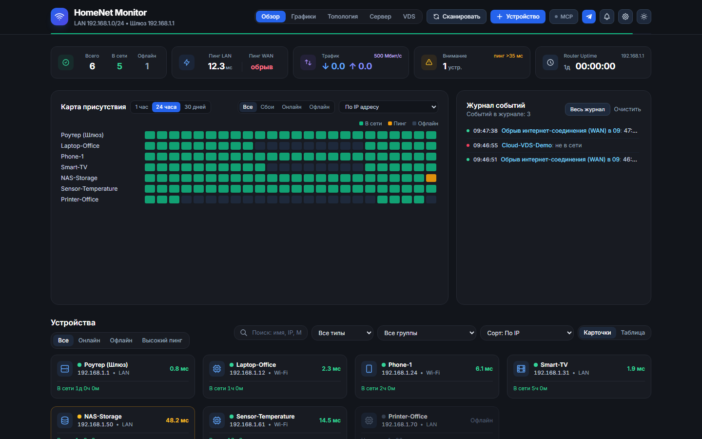
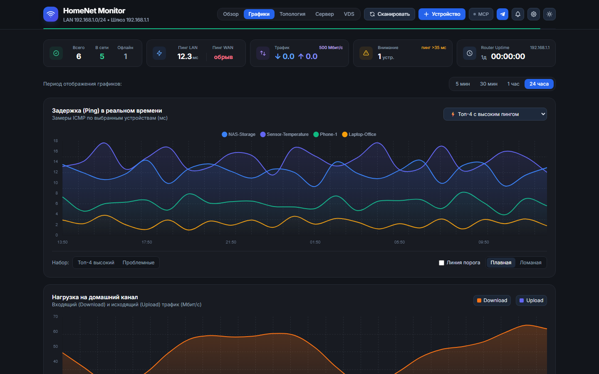
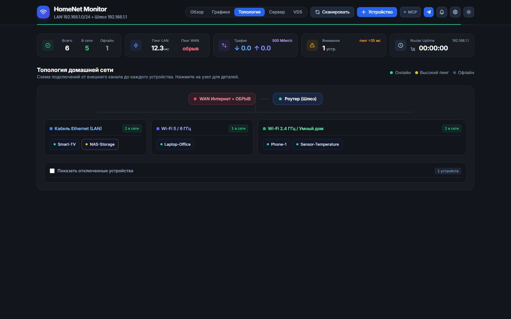
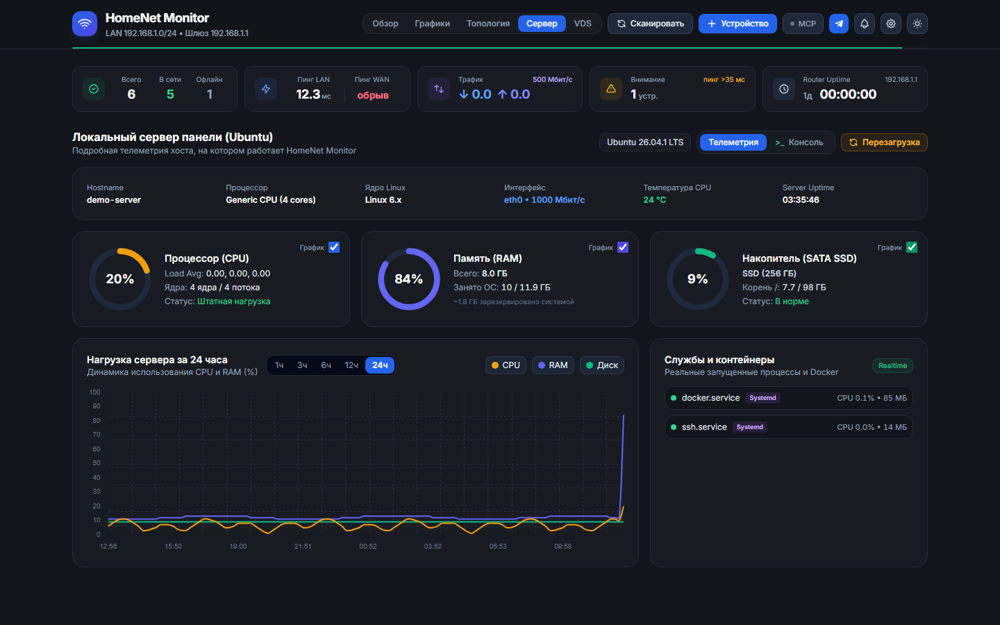
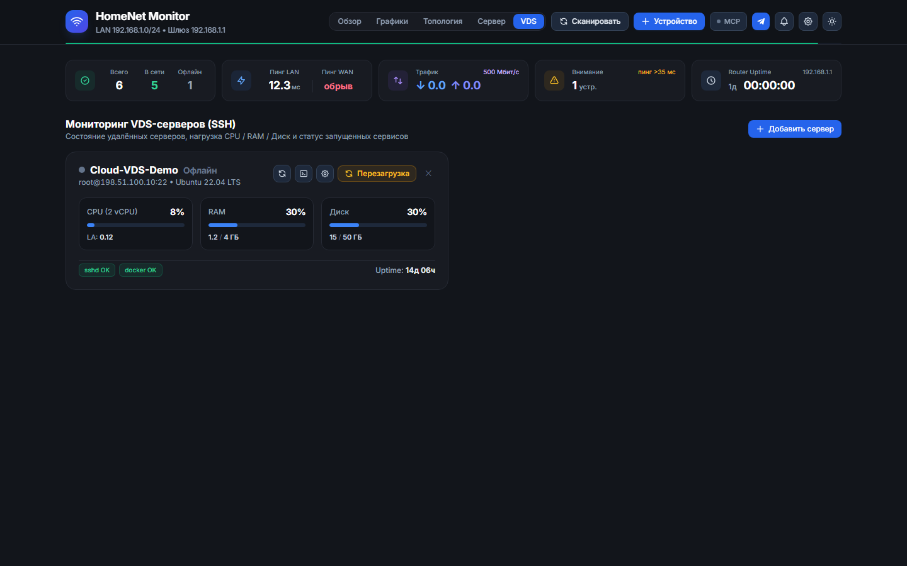
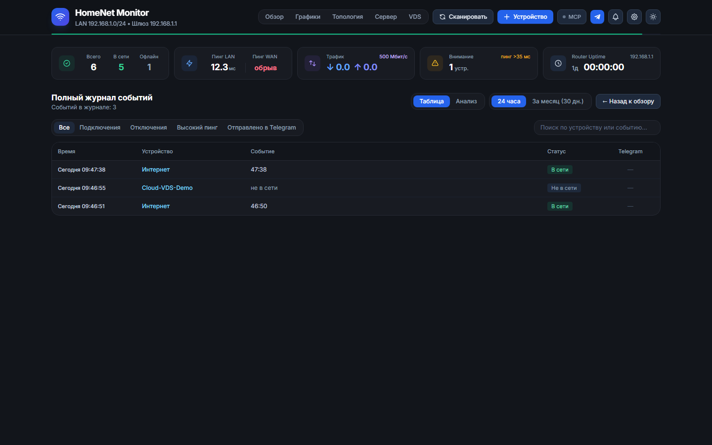
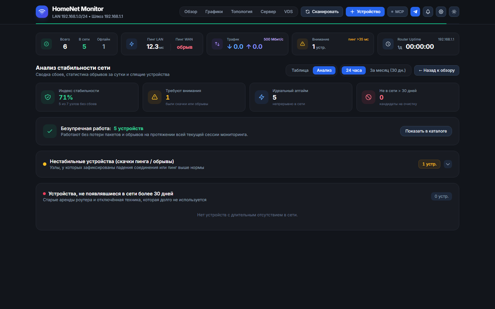
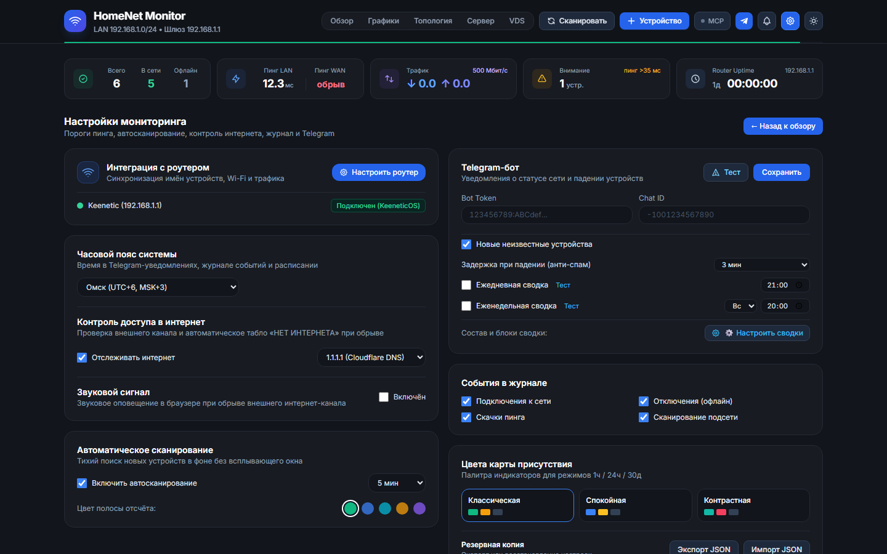

# HomeNet Monitor

<div align="center">

**Самостоятельный дашборд мониторинга домашней сети, сервера и VDS**

[](https://www.docker.com/)
[](https://nodejs.org/)
[](LICENSE)

</div>

HomeNet Monitor — это лёгкий self-hosted веб-интерфейс, который в одном окне показывает:

- состояние всех устройств домашней сети (онлайн / офлайн / высокий пинг);
- топологию подключений от WAN-канала до каждого устройства;
- графики задержки, трафика и загрузки сервера;
- телеметрию хост-машины (CPU, RAM, диск, температура, Docker-контейнеры);
- список VDS-серверов с пингом, нагрузкой и SSH-терминалом;
- журнал событий и аналитику по сети;
- Telegram-уведомления и ежедневные/еженедельные сводки;
- MCP-сервер для подключения ИИ-ассистента (OpenCode, Claude Desktop и др.).

Проект написан на чистом Node.js без внешних npm-зависимостей. Фронтенд — один HTML-файл с Tailwind CSS через CDN.

---

## Содержание

- [Возможности](#возможности)
- [Скриншоты](#скриншоты)
- [Быстрый старт](#быстрый-старт)
- [Настройка](#настройка)
- [Вкладки интерфейса](#вкладки-интерфейса)
- [Роутеры](#роутеры)
- [Telegram-уведомления](#telegram-уведомления)
- [MCP-интеграция](#mcp-интеграция)
- [Docker и reverse proxy](#docker-и-reverse-proxy)
- [Безопасность](#безопасность)
- [Обновление](#обновление)
- [Устранение неполадок](#устранение-неполадок)
- [Лицензия](#лицензия)

---

## Возможности

|Возможность|Описание|
|---|---|
|**Обзор**|KPI-карточки (в сети, офлайн, пинг LAN/WAN, трафик), список устройств с фильтрами, быстрое добавление устройство|
|**Графики**|История пинга, входящий/исходящий трафик,нагрузка канала с настраиваемой скоростью тарифа|
|**Топология**|Дерево WAN → роутер → LAN / Wi-Fi 5 ГГц / Wi-Fi 2.4 ГГц, кликабельные узлы|
|**Сервер**|CPU, RAM, диск, температура, uptime, загрузка ядра, список Docker-сервисов, терминал|
|**VDS**|Карточки удалённых серверов: пинг, CPU, RAM, диск, uptime, сервисы, SSH-команды|
|**Журнал**|Все события сети с фильтрами и режимом «Анализ»|
|**Настройки**|Часовой пояс, автосканирование, роутер, Telegram, логирование, экспорт/импорт JSON|

Дополнительно:

- **Порог высокого пинга** и **пропускная способность линии** настраиваются кликом по верхним KPI-карточкам — в модальных окнах с пресетами и живым предпросмотром.
- **MCP-настройки** открываются кнопкой `MCP` в шапке.
- Все czasы отображаются в системном часовом поясе (`TZ`), по умолчанию `Europe/Moscow`.

---

## Скриншоты

### Обзор



### Графики



### Топология сети



### Хост-сервер



### VDS-серверы



### Журнал событий



### Аналитика



### Настройки



> Все скриншоты сделаны на чистом демо-шаблоне: вымышленные имена устройств и подсеть `192.168.1.0/24`. Реальных приватных данных на них нет.

---

## Быстрый старт

### Вариант 1: Docker Compose (рекомендуется)

```bash
git clone https://github.com/<your-username>/homenet-monitor.git
cd homenet-monitor
cp .env.example .env
nano .env                 # обязательно задайте SUBNET_PREFIX и GATEWAY_IP
docker compose up -d
```

Откройте `http://<ip-вашего-сервера>:3001`.

### Вариант 2: Node.js без Docker

```bash
git clone https://github.com/<your-username>/homenet-monitor.git
cd homenet-monitor
cp .env.example .env
node server.js
```

Для сбора статистики Docker и SSH-команд установите утилиты:

```bash
# Debian / Ubuntu
sudo apt install -y sshpass iputils-ping

# Alpine
apk add --no-cache openssh-client sshpass iputils
```

### Структура проекта

```
homenet-monitor/
├── server.js                 # backend: API, опрос сети, Telegram, MCP
├── homenet_monitor.html      # веб-интерфейс (одна страница)
├── Dockerfile
├── docker-compose.yml
├── .env.example
├── package.json
├── LICENSE
├── README.md
├── docs/
│   └── screenshots/          # скриншоты для этого README
└── data/
    ├── settings.json         # текущие настройки (создаётся при запуске)
    ├── devices.json          # база устройств
    ├── vds.json              # список VDS
    ├── events.json           # журнал событий
    └── *.example.json        # чистые шаблоны для восстановления
```

---

## Настройка

Все параметры можно задать либо в файле `.env`, либо прямо в интерфейсе (вкладка «Настройки»).

|Переменная|По умолчанию|Назначение|
|---|---|---|
|`PORT`|`3001`|Порт веб-сервера|
|`TZ`|`Europe/Moscow`|Часовой пояс для журнала и Telegram|
|`SUBNET_PREFIX`|`192.168.1.`|Подсеть для сканирования|
|`GATEWAY_IP`|`192.168.1.1`|IP шлюза|
|`WAN_TARGET`|`1.1.1.1`|Хост для проверки интернета|
|`ROUTER_TYPE`|`keenetic`|`keenetic`, `openwrt` или `none`|
|`ROUTER_IP`|`192.168.1.1`|IP роутера|
|`ROUTER_USER` / `ROUTER_PASS`|`admin` / пусто|Логин и пароль роутера|
|`TG_TOKEN` / `TG_CHAT_ID`|пусто|Telegram-бот и чат|
|`HOST_SSH_USER` / `HOST_SSH_PASS`|пусто|SSH-доступ к хост-серверу (вкладка «Сервер», терминал)|
|`HOST_SSH_IP`|`127.0.0.1`|Адрес хост-сервера для SSH|

> **Совет:** не храните реальные токены и пароли в `.env` в публичном репозитории. Файл `.env` добавлен в `.gitignore`.

### Часовой пояс

Вкладка «Настройки» → «Системные параметры» → **Часовой пояс системы**. Поддерживаются любые значения формата IANA (`Europe/Moscow`, `Asia/Omsk`, `UTC`). Он влияет на:

- время в уведомлениях Telegram;
- записи журнала событий;
- ежедневные и еженедельные сводки.

---

## Вкладки интерфейса

### Обзор

Верхние карточки интерактивны:

- клик по **«Пинг»** или надписи `пинг >35 мс` открывает окно настройки порога;
- клик по **«Трафик»** открывает окно скорости канала;
- клик по бейджу **MCP** в шапке открывает настройки интеграции.

### Топология

Дерево строится автоматически по данным ARP-таблицы и роутера. Нажмите на узел, чтобы открыть детальную карточку устройства.

### Сервер

Показывает реальные показатели машины, на которой запущен мониторинг. Для доступа к Docker-статистике смонтируйте `/var/run/docker.sock` (уже есть в `docker-compose.yml`).

### VDS

Добавьте сервер через интерфейс. Поддерживаются:

- проверка пинга и uptime;
- CPU / RAM / диск;
- список сервисов;
- произвольные SSH-команды через встроенный терминал.

---

## Роутеры

### Keenetic

1. Создайте на роутере пользователя только для чтения.
2. В «Настройках» выберите тип `Keenetic`, укажите IP, логин и пароль.
3. Нажмите **«Проверить подключение»**.

Монитор считывает hotspot-клиентов, определяется тип подключения (Ethernet / Wi-Fi 2.4 / Wi-Fi 5) и hostname устройств.

### OpenWrt

Аналогично, тип `OpenWrt`. Используется ubus RPC.

### Без роутера

Выберите `Без роутера` — тогда используются только ARP-таблица ядра и ручной список устройств.

---

## Telegram-уведомления

1. Создайте бота через [@BotFather](https://t.me/BotFather).
2. Узнайте Chat ID (например, через [@userinfobot](https://t.me/userinfobot)).
3. Введите токен и Chat ID в разделе «Telegram-бот».

Доступные события:

- появление нового устройства;
- подключение / отключение устройства;
- превышение порога пинга;
- ежедневная сводка (по умолчанию 21:00);
- еженедельная сводка (по умолчанию воскресенье, 20:00).

Для каждого устройства можно включить персональное наблюдение прямо в его карточке.

---

## MCP-интеграция

HomeNet Monitor предоставляет MCP-эндпоинт `/mcp` для ИИ-ассистентов.

1. Нажмите бейдж **MCP** в шапке.
2. Включите доступ и выберите режим:
   - `Только чтение` — безопасный режим по умолчанию;
   - `Чтение + управление сервисами`.
3. При необходимости сгенерируйте новый токен.
4. Нажмите **«Копировать JSON»** и вставьте конфиг в `opencode.json` или другой MCP-клиент.

Пример конфигурации:

```json
{
  "mcpServers": {
    "homenet": {
      "url": "http://192.168.1.10:3001/mcp",
      "headers": { "Authorization": "Bearer hn_mcp_..." },
      "mode": "readonly"
    }
  }
}
```

> Если используете reverse proxy, замените адрес на публичный URL вашего домена.

---

## Docker и reverse proxy

### Пример nginx

```nginx
location /homenet/ {
    proxy_pass http://127.0.0.1:3001/;
    proxy_set_header Host $host;
    proxy_set_header X-Real-IP $remote_addr;
    proxy_set_header X-Forwarded-For $proxy_add_x_forwarded_for;
    proxy_set_header X-Forwarded-Proto $scheme;
    proxy_http_version 1.1;
    proxy_set_header Upgrade $http_upgrade;
    proxy_set_header Connection "upgrade";
}
```

После этого интерфейс будет доступен по `http://<host>/homenet/`.

### Датчики температуры

В `docker-compose.yml` уже смонтирован `/sys/class/hwmon` — на Linux это позволяет читать температуру CPU без дополнительных агентов.

---

## Безопасность

- Проект **не имеет встроенной авторизации**. Используйте reverse proxy с Basic Auth, VPN или firewall.
- Все секреты вынесены в переменные окружения; демо-файлы в `data/` не содержат реальных токенов.
- Перед публикацией проверьте `data/settings.json`, `data/vds.json` и скриншоты — в них не должно быть ваших паролей.
- Для SSH-команд используйте отдельного пользователя с минимальными правами.

---

## Обновление

```bash
cd homenet-monitor
git pull
docker compose up -d --build
```

Настройки и база устройств хранятся в `./data`, поэтому не теряются при обновлении.

Чтобы вернуть чистое состояние, скопируйте `*.example.json` в обычные файлы:

```bash
cp data/devices.example.json data/devices.json
cp data/settings.example.json data/settings.json
cp data/vds.example.json data/vds.json
echo "[]" > data/events.json
```

---

## Устранение неполадок

**Список устройств пуст**
Проверьте `SUBNET_PREFIX`, права на чтение ARP-таблицы (`ip neigh`) и доступ к роутеру.

**Вкладки Топология / Сервер / VDS пустые**
Убедитесь, что вы используете последнюю версию `homenet_monitor.html` — в предыдущих сборках мог быть не закрыт контейнер настроек.

**Нет данных по VDS**
Проверьте, что в контейнере установлен `sshpass`, а в карточке сервера указаны верные IP, порт, пользователь и пароль.

**Не приходят Telegram-сообщения**
Проверьте токен и Chat ID, а также что бот добавлен в чат. Время сообщений соответствует `TZ`.

**Порт 3001 занят**
Измените `PORT` в `.env` и пробросьте новый порт в `docker-compose.yml`.

---

## Лицензия

[MIT](LICENSE) — свободное использование, модификация и распространение с указанием авторства.

---

<div align="center">

Если проект оказался полезным — поставьте ⭐ в репозитории.

</div>
